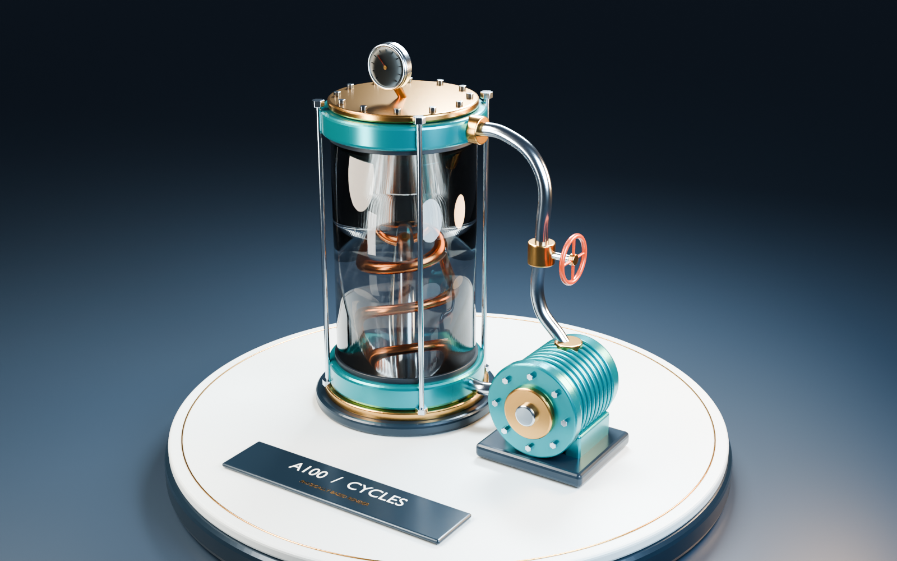

# Colab Blender Render MCP Bridge

Постоянное соединение локального агента с Google Colab через официальный `googlecolab/colab-mcp`, файловая очередь запросов и воспроизводимый Blender Cycles GPU test. Репозиторий содержит инструкции продолжения, код, ноутбуки и проверенный результат A100, чтобы следующий агент мог начать работу без предыдущего чата.

**A100-рендер завершён 8 ноября 2026; его исходные файлы восстановлены и проверены 9 ноября. Последняя проверка соединения MCP — 9 ноября 2026, 09:32:50 UTC. Тогда рабочая среда была CPU, без установленного Blender.** Это сохранённый checkpoint; доступность процесса, вкладки и GPU при новом подключении проверяется заново.

## Вход для следующего агента

Прочитать по порядку: **[AGENTS.md](AGENTS.md) → [state.md](state.md) → этот README → [маршруты](docs/agent-routes.md)**. Затем выбрать один сценарий:

| Ситуация | Рабочий маршрут | Условие завершения |
| --- | --- | --- |
| Продолжить на настроенном MSI | [Подключение к существующему проекту](docs/connect-existing.md) | Свежий heartbeat, 8 инструментов, правильный notebook |
| Подготовить новый Windows-компьютер или новый clone | [Установка](docs/setup-windows.md) | Закреплённый vendor, отдельный Python, patch; затем bootstrap |
| Bridge/вкладка перестали отвечать | [Восстановление соединения](docs/recover-connection.md) | Разобрана очередь; верная вкладка и, при необходимости, успешный smoke |
| Выполнить новый рендер по отдельному заданию | [Рендер и экспорт](docs/render-and-export.md) | Фактическая A100, новый output, проверенный ZIP вне Colab |
| Изучить уже полученный результат | [Происхождение и артефакты](docs/provenance.md) | Проверены исходный ZIP, manifest и отчёт |
| Передать управление другому агенту | [Готовый handoff](docs/handoff.md) | Обновлён state; следующий агент знает статус активных запросов |

Для одного live bridge, notebook и runtime назначается один ведущий агент. Проверяющие агенты работают с локальными копиями и выделенными файлами. Инструкции прошлых этапов сохранены в [истории](docs/history/README.md); текущие правила задаёт корневой `AGENTS.md`.

## Что уже подтверждено

| Параметр A100-прогона | Измеренный результат |
| --- | --- |
| Дата и MCP request ID | 2026-11-08; `a100_pipeline_20261108_v1_run_3` |
| Статус | `success_verified_a100`, `target_a100_met: true` |
| Blender | 4.5.15 LTS, build `5afeabba6097` |
| GPU | NVIDIA A100-SXM4-80GB, 81 920 MiB; driver 580.82.07 |
| Рендер | Cycles CUDA, 1600 × 1000, 96 samples, AgX |
| Проверка вычислений | CPU tracing отключён; GPU UUID/PID подтверждены CSV; 8 проверок успешны |
| Время | 490,448 с рендера; 493,933 с MCP-вызова |
| Телеметрия | 1 960 GPU samples, 1 955 Blender process samples; пик 99%, 3 168 MiB |

Источник — [оригинальный report](evidence/a100/render_report.json), [MCP-ответ](evidence/a100/a100_render_mcp_evidence.json) и [проверка восстановления](evidence/a100/archive_recovery_verification.json). Около 483 секунд первого прогона прошло до первого sample при подготовке CUDA kernels; эти 490,448 с нельзя считать установившейся скоростью рендера или напрямую сравнивать с историческим L4. OpenImageDenoise использует CPU после GPU tracing. Сцена — процедурная демонстрация материалов и освещения, а не инженерная модель оборудования.



**[Скачать исходный A100 ZIP](artifacts/a100/Blender_Colab_A100_Render_2026-11-08.zip)** — 2 792 148 байт. Внутри `.blend`, PNG, полный report, CSV, логи, установщик, renderer и manifest. SHA256:

```text
1ff57a0dfd72144ee4459644f33f14954042c7ad410ee425ed7415e4b1bfe7cf
```

Проверка после clone, без подключения Colab и установки Blender:

```powershell
python .\scripts\verify_bundle.py .\artifacts\a100\Blender_Colab_A100_Render_2026-11-08.zip --expect-sha256 1ff57a0dfd72144ee4459644f33f14954042c7ad410ee425ed7415e4b1bfe7cf
```

## Точки подключения и версии

| Объект | Значение |
| --- | --- |
| Существующий проект на MSI | `C:\Users\Ivan\Projects\colab-blender-mcp` |
| Рабочий документ | [Blender_Colab_A100_Working_2026-11-09](https://colab.research.google.com/drive/1vioZDVMV7P_eCazGrLWQ0C17mIFJJpqS) |
| Исторический документ | [A100 notebook](https://colab.research.google.com/drive/10fsfs2oTmAX8pugr-hK0mo1nodmDB7qK) |
| Upstream | [googlecolab/colab-mcp](https://github.com/googlecolab/colab-mcp/tree/b9ab3899e0f1fa493390b1fd6d54aa2e464ecdf1), commit `b9ab3899e0f1fa493390b1fd6d54aa2e464ecdf1` |
| Проверенная установка bridge | package 1.0.1, Python 3.13.18, uv 0.13.7 |
| Python в существующем проекте | `vendor\colab-mcp\.venv\Scripts\python.exe` |
| Colab work directory | `/content/colab_blender` |
| Blender archive | 4.5.15 Linux x64; SHA256 `0d2b8bb2efe97e6c8eb57de6b7322f8800e1984e3125b60decca5f6771e4773e` |

Clone этого репозитория и существующий проект на MSI — разные каталоги. Clone не переносит процесс, `.venv`, browser binding или очередь. Для продолжения существующей сессии использовать путь MSI; для новой установки — отдельный [setup route](docs/setup-windows.md).

## Структура проекта

| Путь | Назначение |
| --- | --- |
| [AGENTS.md](AGENTS.md), [state.md](state.md) | Правила работы и фактический checkpoint |
| [mcp_bridge.py](mcp_bridge.py), [mcp_call.py](mcp_call.py) | Одна постоянная stdio-сессия и CLI файловой очереди; сохранены в корне |
| [config/project.json](config/project.json) | Несекретные идентификаторы, закреплённые версии и точки входа |
| [config/agent-routes.json](config/agent-routes.json) | Машиночитаемая карта сценариев и переходов |
| [scripts/windows](scripts/windows) | Подготовка vendor и запуск bridge |
| [scripts/blender](scripts/blender) | Полные исходники Blender installer и сцены |
| [scripts/recovery](scripts/recovery) | Извлечение исторического архива; отдельная папка одноразового восстановления |
| [scripts/verify_bundle.py](scripts/verify_bundle.py) | Проверка ZIP CRC, путей, состава и manifest SHA256 без распаковки |
| [patches/colab-mcp-windows.patch](patches/colab-mcp-windows.patch) | IPv4 loopback, shield startup task, WebSocket limit 16 MiB |
| [notebooks](notebooks) | Шаблон для новых запусков и неизменённый фактический UI-экспорт |
| [docs](docs) | Подключение, восстановление, архитектура, ограничения, история и handoff |
| [evidence](evidence) | Первичные отчёты A100/L4, MCP recovery и карта происхождения |
| [artifacts/a100](artifacts/a100) | Проверенный исходный архив результата |

## Два ноутбука с разным назначением

- [Blender_Colab_GPU_Test.ipynb](notebooks/Blender_Colab_GPU_Test.ipynb) — 14 ячеек без outputs, самостоятельный шаблон для нового запуска. При переносе исправлены устаревшие L4 metadata и согласованы уникальный каталог результата с экспортом ZIP. Встроенные `install_blender.py` и `render_test.py` сохранены побайтно. [Описание изменений](notebooks/README.md).
- [Blender_Colab_A100_Working_2026-11-09.ipynb](notebooks/Blender_Colab_A100_Working_2026-11-09.ipynb) — неизменённый экспорт сохранённого Drive-документа: 15 ячеек, включая CPU smoke. Его SHA256 и источник зафиксированы в [verification](evidence/recovery/verification.json). Это доказательство checkpoint, а не обещание GPU в текущей VM.

Тяжёлый исторический notebook с base64-архивом сохранён в полном исходном пакете; для повседневной работы использовать лёгкие копии. Его зависание после reload наблюдалось, но техническая причина не установлена.

## Контракт bridge, который нельзя пропустить

`--status` с exit 0 означает, что файл статуса прочитан. Проверять `state`, свежесть `heartbeat_at`, принадлежность процесса и затем инструменты notebook. `--detach` подтверждает только постановку в очередь. Даже `ok: true` у bootstrap может содержать `result.structuredContent.result: false`.

Очередь выполняется последовательно; сортировка идёт по именам запросов, поэтому для зависимых операций дожидаться результата предыдущей. CLI timeout не отменяет удалённый код. `__shutdown__` ждёт своей очереди, не прерывает текущую операцию и не гарантирует обработку остальных pending requests. Подробности, exit codes и восстановление неопределённого результата — в [архитектуре](docs/architecture.md).

## Проверка передачи

Результаты технической проверки репозитория и границы проверки записаны в [validation report](evidence/provenance/repository_validation.json). Новая установка на Windows и новый GPU-рендер при переносе не запускались. Старый bridge на MSI не перезапускался. Следующему агенту нужно проверить живую сессию только если его задача требует работы с Colab.
