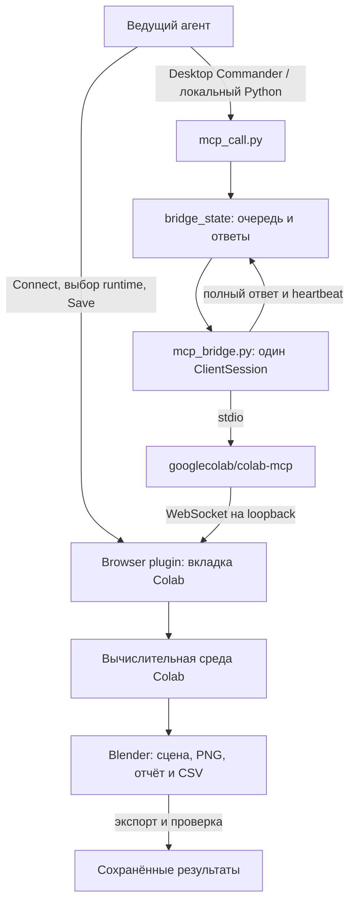

# Архитектура и границы подтверждения

Проект управляет открытым Google Colab через официальный `googlecolab/colab-mcp`. Локальный bridge работает на компьютере, к которому подключён браузер пользователя. Blender исполняется в вычислительной среде Colab. Публикация этого репозитория сама по себе не создаёт bridge, браузерное подключение или GPU-сессию.

Текущие адреса документов и последний проверенный checkpoint находятся в [state.md](../state.md). Для выбора операции используется [карта маршрутов](agent-routes.md).

## Два канала управления

Browser нужен для штатного подключения вкладки, выбора вычислительной среды и явного сохранения документа. Инструменты MCP добавляют, читают, меняют и исполняют ячейки подключённого документа. Remote Desktop Commander предоставляет доступ к локальному Python и файлам на MSI. Это разные поверхности управления, которыми распоряжается один ведущий агент.

Linux-среда, где другой агент читает этот Git-репозиторий, не становится тем же Windows-компьютером или браузером. На новом компьютере сначала применяется [установка для Windows](setup-windows.md); на существующем MSI — [подключение к подготовленной среде](connect-existing.md).

## Компоненты и ответственность

| Компонент | Ответственность | Состояние на диске |
| --- | --- | --- |
| [mcp_call.py](../mcp_call.py) | Отправка одного запроса; чтение status или результата; ожидание ответа | Создаёт резервирование ID и запрос в `bridge_state/inbox/` |
| [mcp_bridge.py](../mcp_bridge.py) | Долгоживущий stdio `ClientSession`; последовательная обработка запросов; полные ответы | `bridge_state/status.json`, `tools.json`, `initialize.json`, каталоги очереди |
| `vendor/colab-mcp/` | Зафиксированный официальный сервер с локальным patch | Отдельное `.venv`; устанавливается локально, не хранится в Git |
| Вкладка Colab | Frontend инструментов ячеек и пользовательское сохранение | Сохранённый документ Drive и несохранённые изменения вкладки — отдельные состояния |
| Colab runtime | Python, NVIDIA GPU при наличии, Blender, `/content/colab_blender` | Временные файлы VM; сохранение notebook не закрепляет `/content` |
| [Компактные доказательства](../evidence/) и [архив A100](../artifacts/a100/Blender_Colab_A100_Render_2026-11-08.zip) | Проверяемая история выполненных действий | Версионируются в Git; происхождение описано в [provenance.md](provenance.md) |

`mcp_bridge.py` и `mcp_call.py` оставлены в корне: их default project directory вычисляется из собственного пути. Оба клиента должны использовать один project directory. Если указан `--project-dir`, он должен совпадать у bridge и CLI; перенос одного скрипта без изменения этой настройки создаст другую очередь. Даже при явном `--server` рабочий каталог upstream определяется как `project_dir/vendor/colab-mcp`.

## Жизненный цикл запроса

1. CLI читает `status.json`. Новая отправка принимается только при `state: ready` или `executing` и возрасте heartbeat не более 20 секунд.
2. CLI создаёт уникальный ID, эксклюзивно резервирует его и атомарно пишет JSON запроса в `inbox/`. Без `--request-id` имя формируется из UTC-времени и UUID.
3. Bridge атомарно переносит запрос в `processing/`, записывает `active_request` и выполняет один инструмент через существующий ClientSession.
4. Полный ответ сначала сохраняется в `outbox/`, затем обработанный запрос переносится в `archive/`. CLI по умолчанию печатает краткую сводку и путь к полному ответу.
5. `--result` читает или ожидает уже существующий ID. Новый RPC при этом не отправляется.

Обработка последовательная. Кандидаты выбираются сортировкой имён файлов; пользовательские ID могут изменить порядок относительно времени отправки. Поэтому очередь не следует описывать как строгую FIFO для произвольных ID.

Резервирование ID, проверка существующих файлов и OS lock уменьшают риск повторной локальной отправки и второго bridge. Они не доказывают однократное исполнение внешнего действия после обрыва транспорта. После аварии оставшиеся `processing` запросы получают `execution_uncertain: true`, если готового ответа ещё нет, и архивируются без replay. Сначала проверяется фактический эффект в Colab.

## Таймауты и остановка

| Механизм | Предел или поведение | Практическое следствие |
| --- | --- | --- |
| Heartbeat | Bridge обновляет его примерно каждые 2 секунды | Свежесть подтверждает локальный процесс; frontend проверяется отдельно |
| `--wait-timeout` CLI | По умолчанию 660 секунд | Это ожидание клиента, включая очередь; его истечение не отменяет запрос |
| `--tool-timeout` | Больше 0 и не более 600 секунд | Ограничивает ожидание обработки RPC; удалённые эффекты после ошибки могут остаться |
| `__shutdown__` | Обычный последовательный запрос очереди | Выполняется после активного RPC; не служит прерыванием рендера |
| OS instance lock | Один владелец одной очереди | Второй bridge для этого project directory отклоняется |

`--detach` позволяет получить ID сразу. Для долгого действия следует сохранить этот ID, наблюдать текущий статус и читать его ответ. Изменяющий запрос после таймаута не повторяется до проверки результата и notebook. Состояние процесса, executable и command line проверяются заново перед аварийной остановкой; исторические PID и listener port не являются адресами следующего запуска.

## Что означает успешная проверка

| Уровень | Доказательство | Что этим установлено |
| --- | --- | --- |
| Локальный клиент | Свежий heartbeat и принадлежность процесса | Нужный bridge работает |
| Bootstrap | Полный ответ `open_colab_browser_connection`, включая `result.structuredContent.result` | Семантический результат штатной попытки подключения |
| Инструменты frontend | Свежий `__list_tools__` и фактические schemas | Набор инструментов текущей сессии; исторически после подключения их было 8 |
| Идентичность документа | URL нужного notebook и `get_cells` со знакомыми исходниками | Управляется нужный документ, а не пустой setup scratchpad |
| Исполнение | Небольшая реальная smoke-ячейка с проверенным выводом | Ячейки этого документа исполняются в его текущей VM |
| Сохранение | Явное **Файл → Сохранить**, затем **«Изменения сохранены»** | Изменения документа сохранены в Drive |
| Результат рендера | Новый report, PNG, `.blend`, GPU/process CSV и проверенный экспорт | Фактический GPU-рендер и сохранённые результаты конкретного запуска |

Внешнее `ok: true` обозначает отсутствие MCP `isError` в возвращённом ответе. Для bootstrap оно может сопровождаться `structuredContent.result: false`. Для исполненной ячейки отдельно проверяются вывод, ошибочные outputs и требуемый результат. Полный bootstrap-ответ следует инспектировать локально без публикации авторизационных данных.

## Зафиксированный upstream и три правки

Проверенная основа: `googlecolab/colab-mcp`, revision `b9ab3899e0f1fa493390b1fd6d54aa2e464ecdf1`, package 1.0.1; Python 3.13.18 и uv 0.13.7. Установка и применение patch описаны в [setup-windows.md](setup-windows.md).

| Правка | Наблюдавшаяся проблема | Сохранённая граница |
| --- | --- | --- |
| Bind `127.0.0.1` | На Windows `localhost` с `port=0` создавал IPv4/IPv6 listeners на разных портах | Только loopback, без публичного listener |
| `asyncio.shield(self._start_task)` | Истечение общего startup wait отменяло startup task | Внешний таймаут ожидания 60 секунд сохраняется |
| `max_size=16 * 1024 * 1024` | Default 1 MiB закрывал чтение outputs с PNG кодом 1009 | Входящий лимит остаётся конечным; token/Origin-проверки сохранены |

В этой модели browser fragment содержит данные текущего подключения. Он не относится к постоянной конфигурации и не сохраняется в Git, документации или передаваемых логах. Сырые `bridge_state` и логи stdio остаются локальными. Для передачи результата используются отдельно проверенные документы и доказательства.

## Время жизни и владельцы

Одновременно изменяет notebook, runtime и живую очередь только ведущий агент. Проверяющий агент может читать локальные копии, сопоставлять hashes/CSV/report и редактировать явно выделенные документы. Один владелец каждого изменяемого файла назначается до параллельной работы.

Исторический A100-рендер и CPU-smoke восстановления имеют отдельные доказательства. Проверка 9 ноября не резервирует A100 для следующего агента; доступность GPU и содержимое новой VM проверяются при новой реальной задаче. Порядок такого запуска и сохранения результатов описан в [render-and-export.md](render-and-export.md).
